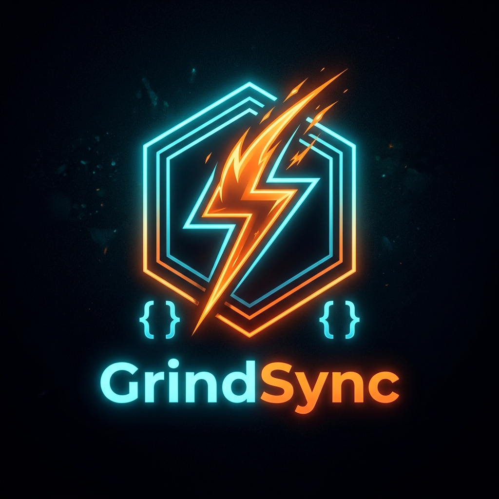

<div align="center">



# ⚡ GrindSync (v2.0.0)

**Automatically capture accepted LeetCode & GeeksForGeeks solutions and synchronize them to GitHub with AI-powered visual explanations, Mermaid flowcharts, and dry-runs.**

[](https://nodejs.org)
[](https://developer.chrome.com/docs/extensions/mv3/intro/)
[](LICENSE)
[](https://github.com/ALLENKISAIRAKESH/GrindSync-2.0.0)

</div>

---

## 🌟 Key Features

- 🧠 **AI Visual Explanations**: Generates comprehensive READMEs for every solution including:
  - **Mermaid Flowchart Diagrams**: Interactive visual logic and algorithm flow representations.
  - **Step-by-Step Visual Dry-Runs**: Clear memory/state trace diagrams.
  - **Intuitive Real-World Analogies**: Everyday analogies making complex concepts effortless to grasp.
  - **Complexity Analysis**: Time and Space complexity breakdowns with rigorous justifications.
- ⚡ **Multi-Platform Support**: Seamlessly captures accepted submissions from:
  - **LeetCode** (`leetcode.com`, `leetcode.cn`) with full bulk GraphQL history sync.
  - **GeeksForGeeks** (`geeksforgeeks.org`, `practice.geeksforgeeks.org`) with live submission capture and active tab detection.
- 📁 **Clean Categorized Hierarchy**: Automatically organizes all solutions into verified difficulty directories (never an `Unknown` folder):
  ```text
  My-Solved-Problems_GrindSync/
  ├── LeetCode/
  │   ├── Easy/
  │   ├── Medium/
  │   └── Hard/
  └── GeeksForGeeks/
      ├── Basic/
      ├── Easy/
      ├── Medium/
      └── Hard/
  ```
- 🚀 **1-Click GitHub Repository Setup**:
  - **Auto-Create Remote**: Provide a Personal Access Token (PAT) with `repo` scope to auto-create `My-Solved-Problems_GrindSync` on your GitHub account via API and push automatically.
  - **Auto-Link**: Automatically initializes local Git repositories and links them to your remote in seconds.
- 🛡️ **Zero CSP Violations & MV3 Compliant**: Uses a MAIN-world `postMessage` bridge (`monaco-bridge.js`) to read Monaco, CodeMirror, and ACE editor buffers without violating Chrome Content Security Policy.

---

## 🏗️ Project Architecture

GrindSync 2.0.0 is organized into a clean, modern TypeScript monorepo:

```text
GrindSync-2.0.0/
├── frontend/          # Chrome Extension (Manifest V3, Vite + TypeScript, Content Scripts & Popup UI)
├── backend/           # Local Fastify Daemon (Git Engine, OpenAI Visual Diagrams, SQLite DB)
├── shared/            # Shared Zod schemas, types, and cross-package utilities
├── package.json       # Monorepo workspace configuration
├── tsconfig.base.json # Shared TypeScript compiler settings
└── README.md          # User Guide & Documentation
```

---

## ⚙️ Prerequisites

Before getting started, make sure you have:

- **Node.js**: `v18.0.0` or higher ([Download Node.js](https://nodejs.org/))
- **Git**: Installed and configured on your system (`git config --global user.name` & `user.email`)
- **Chrome / Chromium Browser**: Version 102+
- *(Optional)* **OpenAI API Key**: For generating AI visual diagram explanations (falls back to clean code documentation if omitted).
- *(Optional)* **GitHub Personal Access Token**: With `repo` scope to enable 1-click automatic repository creation.

---

## 🚀 Quick Start Guide

### Step 1: Clone the Repository

```bash
git clone https://github.com/ALLENKISAIRAKESH/GrindSync-2.0.0.git
cd GrindSync-2.0.0
```

### Step 2: Install Dependencies & Build

Install all monorepo workspace dependencies and compile the packages:

```bash
npm install
npm run build
```

This compiles:
- `shared/` -> `shared/dist`
- `backend/` -> `backend/dist`
- `frontend/` -> `frontend/dist` (the unpacked extension)

---

### Step 3: Configure & Launch the Local Backend

The local backend server runs locally on your machine, managing your Git repository, committing solutions, and optionally querying OpenAI for diagram generation.

1. Create a `.env` file inside `backend/`:
   ```bash
   cp backend/.env.example backend/.env
   ```
2. Configure `backend/.env` with your settings:
   ```env
   PORT=4578
   NODE_ENV=development
   CODESYNC_TOKEN=grindsync-local-dev-token
   CODESYNC_AUTO_PUSH=true
   CODESYNC_COMMIT_FORMAT=feat({platform}): add {problem}
   
   # Optional: Provide OpenAI key for AI-generated visual diagrams & explanations
   OPENAI_API_KEY=your_openai_api_key_here
   ```
3. Start the backend daemon:
   ```bash
   npm run start:backend
   ```
   *The backend will start listening on `http://127.0.0.1:4578`.*

---

### Step 4: Load the Extension in Chrome

1. Open Google Chrome and go to `chrome://extensions/`.
2. Toggle on **Developer mode** in the top right corner.
3. Click **Load unpacked** in the top left.
4. Select the **`frontend/dist`** directory from this repository.
5. You will see **GrindSync** in your extensions toolbar!

---

## 📖 User Guide: Using GrindSync

### 1. Connecting Your GitHub Repository
1. Click the GrindSync extension icon in your Chrome toolbar.
2. Confirm the status pill says **Connected** (to `127.0.0.1:4578`).
3. Click **⚙️ Settings**:
   - **Automatic (Recommended)**: Paste your GitHub Personal Access Token (`repo` scope) and click **🚀 Create on GitHub**. GrindSync creates `My-Solved-Problems_GrindSync` on your account and links it automatically.
   - **Manual**: Enter your local repository path (e.g., `C:\Users\YourName\My-Solved-Problems_GrindSync`) and click **Save Settings**.

---

### 2. Syncing LeetCode Solutions
1. Open [LeetCode](https://leetcode.com).
2. Open GrindSync popup and switch to the **LeetCode** tab.
3. Your solved count, pushed count, and pending count are calculated in real time.
4. Click **🔄 Sync Pending Solutions** to bulk download all past accepted solutions from LeetCode GraphQL and push them to your repository organized by `Easy/`, `Medium/`, and `Hard/`.
5. When solving new problems on LeetCode, every accepted submission is captured and pushed automatically!

---

### 3. Syncing GeeksforGeeks Solutions
1. Open [GeeksforGeeks Practice](https://practice.geeksforgeeks.org).
2. GrindSync tracks your solved problems and checks open problem editors across your browser tabs.
3. **Pushing a Solved Problem**:
   - Open any problem you have previously solved.
   - Click the GrindSync popup icon and click **⚡ Push to GitHub**.
   - Your solution code and AI diagram explanation are committed and pushed to your repo.
4. **Live Auto-Sync**: Whenever you click **Submit** on GeeksforGeeks and all test cases pass, GrindSync automatically captures your code and pushes it to GitHub!

---

## 🧪 Testing

GrindSync comes with a comprehensive test suite covering adapters, path sanitization, database deduplication, and Git workflows:

```bash
# Run all 111 tests across the monorepo
npm test

# Typecheck all workspaces
npm run typecheck
```

---

## 📝 License & Attribution

Created & Maintained by **ALLENKISAIRAKESH**. Protected under the **GrindSync Source-Available & Anti-Plagiarism License**.

> ⚠️ **Strict Non-Claim Protection**: You are welcome to use, explore, and study this software for personal and educational purposes. However, **no individual or entity is permitted to claim, represent, submit, or market this software, codebase, architecture, or derivative works as their own original work or project**. Mandatory author attribution to **ALLENKISAIRAKESH** is required on all public distributions. See [`LICENSE`](LICENSE) for complete terms.
